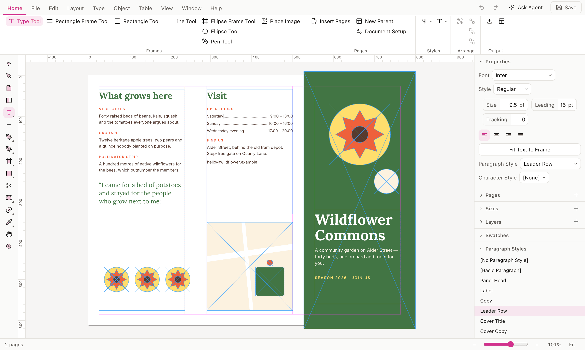
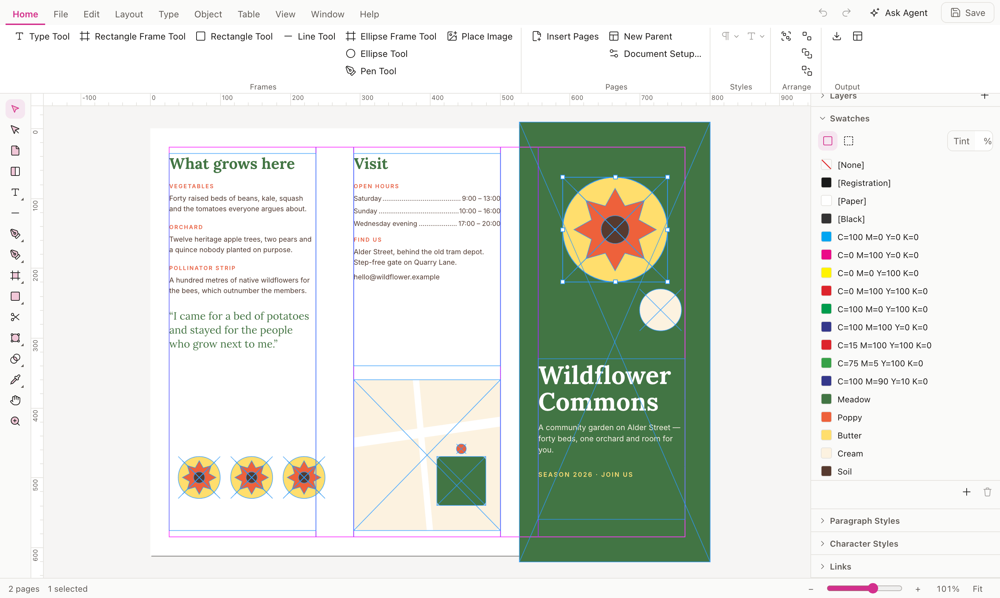
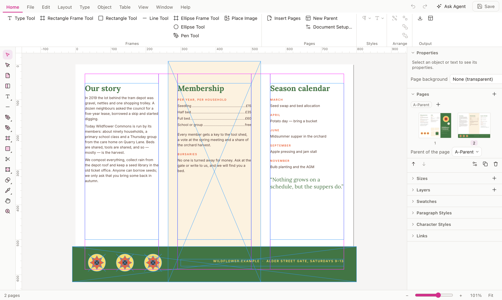
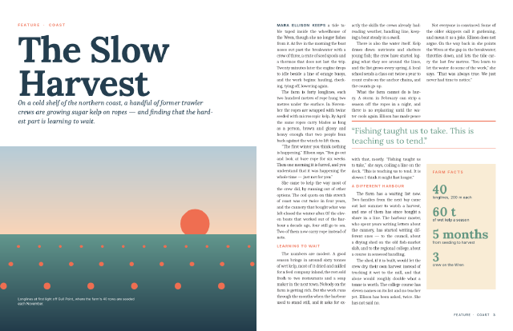
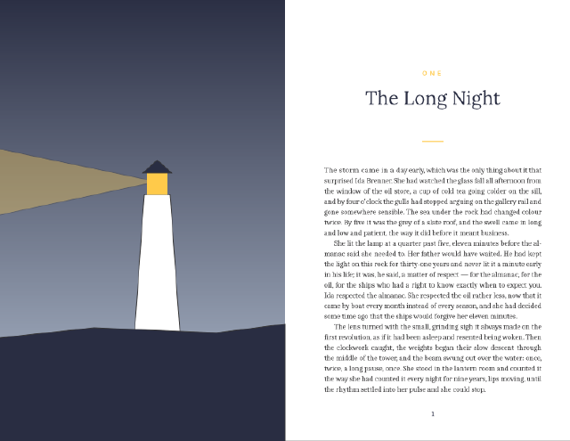
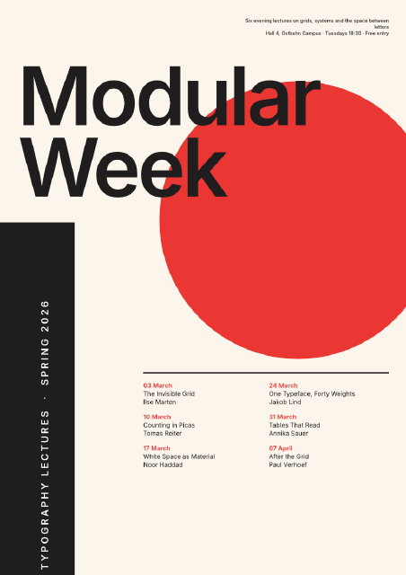

<div align="center">

# Kition Layout

**Kition Layout: a page layout editor for flyers, posters and books, for people and AI agents**

Threaded text frames · Paragraph styles · Swatches and gradients · Pages and guides · Tables · Tools for agents

[](LICENSE)
[](https://www.npmjs.com/package/@kition/embed)
[](https://github.com/kitharness/kitharness)
[](bindings/wasm)

[Use it in Kition](https://kition.ai) · [Embed it](#embed-it-in-your-app) · [Give it to your agent](#give-it-to-your-agent) · [Showcase](https://github.com/KitionAI/kition-showcase/tree/main/layout) · [Developer docs](https://developer.kition.ai) · [KHP](https://github.com/kitharness/kitharness)

</div>

A brochure or a menu usually lives in one desktop program and one file that only it can read. You
send a PDF round for review and type every correction back in by hand. An AI assistant can tell
you what to change, but it cannot open the file and change it.

Layout puts the page layout editor in a browser tab. Pages hold frames, text flows from frame to
frame, and styles and swatches carry the typography and the colour. The same engine runs headless
for an AI agent: it reads your pages, edits the text with the editor's own commands and runs the
same preflight check. An agent's write names the revision it read, so a change that rests on
something you have since edited is refused instead of written over yours.


## What it does

### Why Layout

- **Text goes where you send it.** Thread a story through as many text frames as it needs, and
  give a frame several columns. Shift-click a frame's out port and Layout adds pages until the
  story fits.
- **Styles carry the typography.** Set type once as a paragraph or character style, with tabs,
  leaders and numbered lists. Edit the style and every paragraph that uses it follows.
- **Colour has names.** Fill and stroke from swatches, with opacity, gradients and drop
  shadows. Make a swatch from a hex value and apply it in one click.
- **Pages, guides and layers stay in order.** Insert pages, drag guides from the rulers, lay a
  guide grid over a page and give it a background. Group, stack and hide objects on layers.
- **Your agent works on the same layout.** An AI agent reads the pages, writes and formats text,
  runs the preflight and fixes what it reports. It can work in a draft that you review before
  anything changes.
- **It runs in your web page.** The editor embeds in any page and reads and writes through your
  storage. The engine is Rust, compiled to WebAssembly, and runs in a Web Worker.

### See it

<table>
<tr>
<td width="50%"><br /><b>Paragraph styles</b>: the caret sits in the opening hours, set in the Leader Row style with a right tab and dot leaders.</td>
<td width="50%"><br /><b>Swatches</b>: the brochure's own colours, by name, ready to fill or stroke the selection.</td>
</tr>
<tr>
<td width="50%"><br /><b>Layers and groups</b>: every object on the page in order, groups opened to their parts.</td>
<td width="50%"><br /><b>Pages</b>: move between pages from their thumbnails, and insert more where you need them.</td>
</tr>
</table>

### Made with Layout

<table>
<tr>
<td width="25%"><a href="https://github.com/KitionAI/kition-showcase/tree/main/layout/tideline-magazine-feature"></a></td>
<td width="25%"><a href="https://github.com/KitionAI/kition-showcase/tree/main/layout/riverside-night-market-poster"></a></td>
<td width="25%"><a href="https://github.com/KitionAI/kition-showcase/tree/main/layout/lantern-keeper-novel"></a></td>
<td width="25%"><a href="https://github.com/KitionAI/kition-showcase/tree/main/layout/swiss-grid-lecture-poster"></a></td>
</tr>
</table>

Every sample is built with Layout's own commands. [See all of them](https://github.com/KitionAI/kition-showcase/tree/main/layout).

### Formats

| Opens | Creates | Exports |
| --- | --- | --- |
| `.klayout`; `.idml` for viewing | `.klayout` | `.pdf`, `.png`, `.jpg`, `.html`, `.idml`, `.epub` |

## Quick start

### Use it in Kition

Open or create a `.klayout` file in Kition and it opens in this editor. Kition's agent works on the
same file, with the same commands. [Download Kition](https://github.com/KitionAI/kition/releases/latest).

### Embed it in your app

Layout's editor is a static package you host yourself, mounted into your page with
[`@kition/embed`](https://www.npmjs.com/package/@kition/embed). Download
`kition-layout-<version>.tgz` from the [latest release](https://github.com/KitionAI/kition-layout/releases/latest)
and serve its `layout-ui/` folder on its own origin, with the headers in the
[embed reference](https://github.com/KitionAI/kition-sdk/blob/main/docs/platform/reference/embed.md).
Then:

```ts
import { KitionEmbed } from '@kition/embed'

const editor = await KitionEmbed.mount(document.getElementById('layout')!, {
  kit: { id: 'kit.layout', url: 'https://kits.example.com/layout-ui/' }, // the package you host
  file: { id: 'brochure-2026', name: 'Brochure.klayout' },
  storage: {
    read: async (id) => api.read(id),                                     // { bytes, version }
    write: async (id, bytes, { expectedVersion }) => api.write(id, bytes, expectedVersion), // refuse a stale version
    create: async (name, bytes) => api.create(name, bytes),              // exports (PDF, PNG, ...) become new files
  },
})
```

Every save carries the version it read, so an edit made elsewhere is never written over. The
[embed guide](https://github.com/KitionAI/kition-sdk/blob/main/docs/sdk/embed.md) adds people and
permissions, co-editing, and an agent working in the open editor.

### Give it to your agent

The engine also runs headless, and `kition`, the Kition SDK's command line, serves it as MCP tools
(`layout_inspect`, `layout_run`, `layout_check`, ...) on a folder of layouts, for any MCP client.
Nothing is compiled: you need neither Rust nor the Kition app. Install `kition`, then connect your
agent in the folder:

```sh
curl -fsSL https://github.com/KitionAI/kition-sdk/releases/latest/download/install.sh | sh
# Claude Code, in the folder:
claude mcp add kition -- ~/.kition/bin/kition mcp --workspace "$PWD"
```

On Windows, install it with
`irm https://github.com/KitionAI/kition-sdk/releases/latest/download/install.ps1 | iex`. With
Node.js 20 or later you can skip the install:
`claude mcp add kition -- npx -y @kition/kits-mcp --workspace "$PWD"`.

`kition` holds no kit. The first time the agent opens a `.klayout` file, through the `kit_inspect`
tool the server offers until Layout is installed, `kition` downloads Layout's headless executable
into `~/.kition/kits` and the layout tools appear. `kition kit install layout` downloads it ahead of
time, and `kition kit upgrade` moves it to the newest version. Claude Desktop, Cursor, Codex and the
other commands are in the SDK's
[agent guide](https://github.com/KitionAI/kition-sdk/blob/main/docs/sdk/agent.md#connect-your-agent)
and [`kition` guide](https://github.com/KitionAI/kition-sdk/blob/main/docs/sdk/cli.md). To run a
build of your own (working on the kit itself), see
[docs/development.md](docs/development.md#run-the-headless-kit-for-an-agent).

A real session on a copy of the brochure above, trimmed:

```text
> layout_inspect {"path":"brochure.klayout"}
Opened `brochure.klayout`: 936 × 1440
{"details":{"pageCount":2,"paragraphStyles":["[No Paragraph Style]","[Basic Paragraph]","Panel Head","Label","Copy","Leader Row",…],
  "stories":[…,{"frames":[34],"id":35,"overset":false,
  "preview":"Visit\nOpen hours\nSaturday\t9:00 – 13:00\nSunday\t10:00 – 16:00\nWednesday evening\t17"},…],…},"revision":"hhv0",…}

> layout_run {"path":"brochure.klayout","basis":"hhv0","steps":[
    {"command":"find.change","params":{"find":"10:00 – 16:00","change":"10:00 – 17:00","story":35,"scope":"story"}}]}
Ran 1 commands on `brochure.klayout` (saved): 936 × 1440 Changes: objects 1 changed.
{"changes":{"changed":[{"edits":[{"after":{"excerpt":"…:00\nSunday\t10:00 – 17:00\nWednesday evening\t17:00 – 20:00\nFind us\nAlder Street,…",…},
  "before":{"excerpt":"…:00\nSunday\t10:00 – 16:00\nWednesday evening\t17:00 – 20:00\nFind us\nAlder Street,…",…},…}],"id":35,"type":"Story"}],…},
  "completed":[{"command":"find.change","result":{"count":1}}],"diagnostics":{"new":[],"resolved":[]},"revision":"hhv1","saved":true}

> layout_check {"path":"brochure.klayout"}
Checked `brochure.klayout`: 1 error, no warnings, no notes.
{"diagnostics":[{"code":"layout.missing-font","fix":{"command":"font.replace","params":{"family":"Lora","toFamily":"Source Serif 4"}},
  "message":"Missing font: Lora.","severity":"error","target":{}}]}
```

The agent read the brochure, changed Sunday's closing time in the one story it named, and saved.
The check is the kit's live preflight: here it reports that the program it ran with had no Lora,
the face of the brochure's headings, and names the command that would replace it. The agent
can run that fix, or leave the choice to you. The agent's guide is [agent/guide.md](agent/guide.md).

## Maturity

Version 0.1.0 · KHP 1.0, conformance level `basic`.

| Works today | Partly there | Not yet |
| --- | --- | --- |
| Text threaded through frames, with columns | Export to PDF, EPUB, HTML, images and IDML | Opening `.indd` files |
| Paragraph and character styles, numbered lists | Opening IDML files | Printing, packaging and relinking to a folder in the embedded editor |
| Fills, strokes, swatches, gradients and drop shadows | Chinese and Japanese typography, composite fonts, hyphenation | Crash recovery and colour profiles in the embedded editor |
| Layers, groups, stacking order and transforms | Parent pages, sections and alternate layouts | Interface languages other than English and Simplified Chinese |
| Pages, ruler guides, guide grids and page backgrounds; tables | Footnotes, tables of contents, indexes and cross-references | Plug-ins |

Known gaps: [docs/gaps.md](docs/gaps.md). What's next: [docs/roadmap.md](docs/roadmap.md).

## Build and contribute

Build and test instructions are in [docs/development.md](docs/development.md). Read
[CONTRIBUTING.md](.github/CONTRIBUTING.md) before opening a pull request, and ask questions in
[Discussions](https://github.com/KitionAI/kition/discussions) or on [Discord](https://discord.gg/bFSjRDjVY).

## License

Apache-2.0 ([LICENSE](LICENSE)). Third-party licenses and notices are listed in [NOTICE](NOTICE)
and [docs/attribution.md](docs/attribution.md).

Portions of this kit are derived from a project licensed under the MIT License, used here under
that license and credited in [NOTICE](NOTICE).
